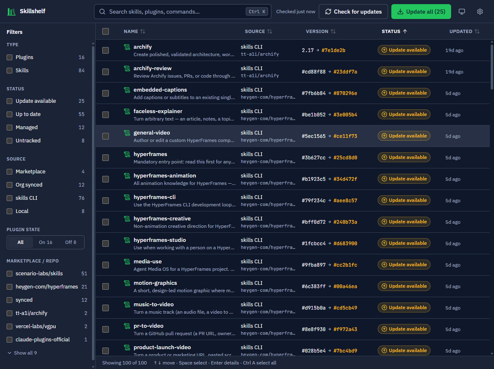

# Skillshelf



A desktop app for the skills and plugins you've installed for Claude Code. It runs on Windows, macOS and Linux. You can:

- **See everything in one list**: marketplace plugins, plugins your claude.ai organization syncs to you, skills installed with the [`skills` CLI](https://skills.sh), hand-made skills in `~/.claude/skills`, and skills in project folders you add.
- **Check what's out of date**: Skillshelf compares each item with its upstream source (see below).
- **Update** one item, a selection, or everything with **Update all**.
- **Filter, sort and search** by type, status, source, marketplace/repo and on/off state. Each filter option shows a count.
- **Enable/disable** plugins, **uninstall** items (always with a confirmation), and open an item's folder or source repo.

## How update checks work

| Source | Detected from | Up-to-date check | Update / uninstall |
|---|---|---|---|
| Marketplace plugin | `claude plugin list --json` + `~/.claude/plugins/installed_plugins.json` | Refreshes catalogs with `claude plugin marketplace update`, then compares semver. If the plugin has no version, it compares the installed commit (git) or the plugin's files with the catalog copy | `claude plugin update/enable/disable/uninstall` |
| Org-synced plugin | same | Shown as **Managed** | enable/disable only |
| `skills` CLI skill | `~/.agents/.skill-lock.json` | Compares the lockfile's folder hash with the folder's current git tree hash on GitHub (one API call per repo) | `npx skills@1 update <name> -g -y`, uninstall unlinks from Claude Code only (`-a claude-code`) |
| Local / project skill | `SKILL.md` folders | **Untracked**, unless the skill ships a `skill-release.json` update manifest | Uninstall moves the folder to the OS trash |

GitHub's anonymous API limit is 60 requests/hour, which is usually enough. If you are signed in with `gh` (or `GITHUB_TOKEN`/`GH_TOKEN` is set), Skillshelf uses that token.

Plugin changes apply after you restart Claude Code. The app shows a reminder when that's needed.

Sometimes a marketplace declares its own install command for an update. When that happens, Skillshelf shows you the exact command and its hash and runs it only if you approve. It never passes `-y` blindly.

## Install

Download the installer for your OS from [Releases](https://github.com/sanchezrobertodev/skillshelf/releases):

| OS | File |
|---|---|
| Windows | `Skillshelf_<version>_x64-setup.exe` (or the `.msi`) |
| macOS (Apple silicon and Intel) | `Skillshelf_<version>_universal.dmg` |
| Linux | `.AppImage`, `.deb` or `.rpm` |

The installers aren't code-signed yet, so the first launch shows a warning:

- **Windows**: SmartScreen shows "Windows protected your PC". Click **More info**, then **Run anyway**.
- **macOS**: Gatekeeper says Apple can't verify the app, or that it is damaged. After dragging Skillshelf to Applications, either click **Open Anyway** in System Settings → Privacy & Security, or run this once:
  ```bash
  xattr -cr /Applications/Skillshelf.app
  ```
- **Linux**: make the AppImage executable (`chmod +x Skillshelf_*.AppImage`) and run it, or install the package with `sudo apt install ./Skillshelf_*.deb` or `sudo dnf install ./Skillshelf-*.rpm`.

## Updates

Skillshelf updates itself with the [Tauri updater](https://v2.tauri.app/plugin/updater/). On launch it checks the latest GitHub release (`latest.json`). If there is a newer version, a banner shows the version and what's new, and **Install & restart** downloads it, verifies its signature and restarts into the new version. **Settings → App updates** has a **Check for updates** button.

- **Linux**: only the AppImage updates itself. If you installed the `.deb` or `.rpm`, download and install the new package.
- **0.1.0** shipped without the updater, so install the next version by hand once. Later versions update themselves.

What's new comes from [CHANGELOG.md](CHANGELOG.md).

## Requirements

- `claude` (Claude Code CLI) on `PATH`, needed for plugins
- `node`/`npx`, needed to update skills installed with the `skills` CLI
- `git`, used for plugin version comparison
- `gh` (optional), raises the GitHub rate limit

The environment section in **Settings** shows which of these were found.

## Develop

Prerequisites: Node 22+, Rust (stable) and the [Tauri prerequisites](https://tauri.app/start/prerequisites/) for your OS.

```bash
npm install
npm run tauri dev      # native window with the real backend
npm run dev            # browser only, uses a mock backend (src/dev/mock.ts)
npm run typecheck
npm test               # cargo test (parsers, version logic, git comparisons)
```

Before pushing, run `make check`. It runs the typecheck, `cargo fmt --check`, `cargo clippy -D warnings` and `cargo test`, which is the same work as the CI `test` job plus lint and format checks. The `Makefile` also has `install`, `test`, `lint`, `fmt`, `dev` and `build`.

`npm run dev` in a plain browser reads `src/dev/snapshot.json` when it exists (git-ignored). To create it from your own install:

```bash
cd src-tauri && SKILLSHELF_DUMP=../src/dev/snapshot.json cargo test real_machine -- --ignored
```

## Build installers

```bash
npm run tauri build
```

Output goes to `src-tauri/target/release/bundle/`: MSI and NSIS on Windows, `.app` and DMG on macOS, AppImage, deb and rpm on Linux. Each OS builds its own installers. The GitHub Actions workflow in `.github/workflows/release.yml` builds all three.

The build also signs the updater bundles, so it needs the updater's private key:

```bash
TAURI_SIGNING_PRIVATE_KEY=~/.tauri/skillshelf.key npm run tauri build
```

Without the key, build without the updater bundles:

```bash
npm run tauri build -- --config src-tauri/tauri.no-updater.conf.json
```

### Release

1. Move the `Unreleased` notes in [CHANGELOG.md](CHANGELOG.md) under a new `## [x.y.z] - date` heading.
2. Set the same version in `package.json`, `src-tauri/tauri.conf.json` and `src-tauri/Cargo.toml`.
3. Push a `vx.y.z` tag. CI creates a draft release with that CHANGELOG section as its notes, plus the installers, the signed updater bundles and `latest.json`. It fails if the section is missing or the tag doesn't match the app version (`node scripts/changelog-section.mjs vx.y.z` runs the same check locally).
4. Publish the draft. Installed apps see the update once it's the latest release.

CI signs with the `TAURI_SIGNING_PRIVATE_KEY` repository secret. The matching public key is in `tauri.conf.json`. If the private key is lost, installed apps can't verify new updates, and every user has to reinstall by hand.

## Layout

```
src-tauri/src/
  scan/        offline discovery of plugins and skills
  updates/     marketplace / GitHub update checks
  actions.rs   update, enable, disable, uninstall (fixed argument lists, validated ids)
  proc.rs      runs CLIs without a shell or console window
src/
  components/  toolbar, filter sidebar, virtualized list, detail panel, activity queue, dialogs
  store.ts     app state (zustand)
design-system/ design tokens and rules (ui-ux-pro-max)
```

## License

[MIT](LICENSE)
